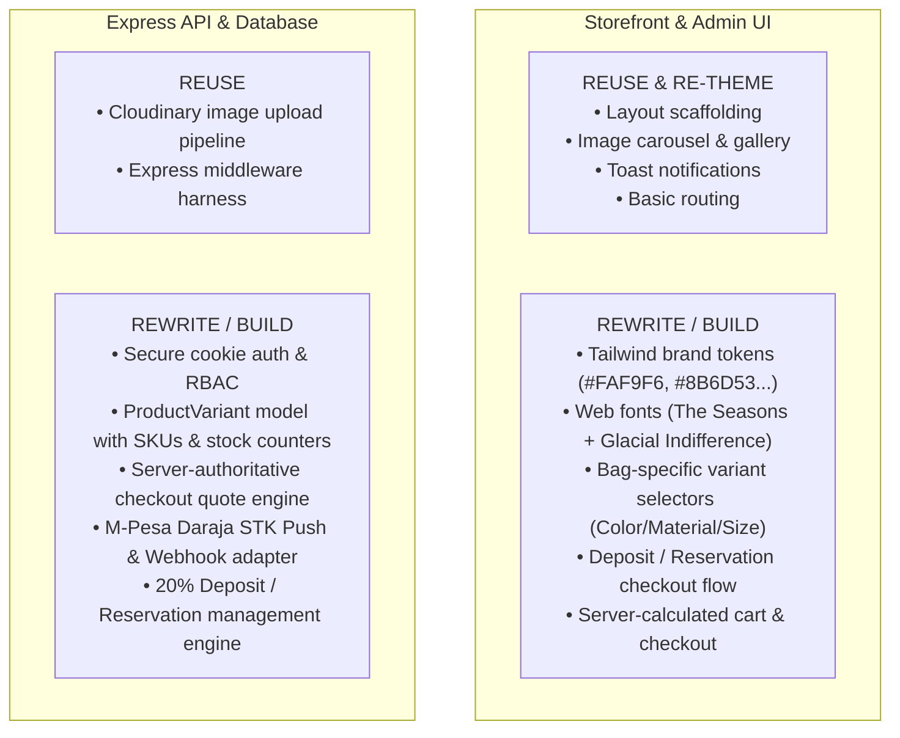

# Milestone 0 (M0) Audit Report & Gap Analysis
**Project:** QNK Noire Bags  
**Target Market Indicator:** Kenya (07-xx phone, Countrywide delivery, M-Pesa reference)  
**Reference Base:** `bhavinvagh/online_clothes_store`

---

## 1. Executive Summary & Audit Verdict

The reference repository provides a functional starting layout (React frontend, Express API, MongoDB models, React Admin dashboard), but **cannot be used for production without substantial architectural refactoring**. 

The codebase was originally built as a demonstration clothing store and contains:
1. **Critical financial & security vulnerabilities** (client-controlled order pricing, unverified payment webhooks, hardcoded admin credentials).
2. **Zero inventory management** (no stock levels, no reservation system, no concurrency control).
3. **Hardcoded clothing domain model** (Men/Women/Kids, Topwear/Bottomwear, clothing sizes S–XXL) that directly conflicts with a specialized **Bags & Accessories** brand.

---

## 2. Technical Codebase Audit Findings

### 🔴 Critical Security & Integrity Flaws

| Subsystem | Existing Implementation | Architectural Requirement | Risk Level |
|---|---|---|---|
| **Pricing Authority** | `placeOrder` & `placeOrderStripe` accept `amount` directly from `req.body` without recalculation. | All prices, discounts, and order totals must be authoritative and calculated on the server from database items. | 🔴 **CRITICAL** (Arbitrary price tampering) |
| **Payment Verification** | `verifyStripe` reads `req.body.success === "true"` with **zero webhook signature verification**. | Server-side webhook listener with cryptographic signature verification (Stripe / M-Pesa Daraja callback). | 🔴 **CRITICAL** (Orders marked paid for free) |
| **Admin Authentication** | Single admin checked via `req.body.email === process.env.ADMIN_EMAIL && req.body.password === process.env.ADMIN_PASSWORD`. Token is `jwt.sign(email+password)`. | Database-backed user roles (`customer`, `admin`, `fulfilment`) with revocable sessions and Argon2id hashing. | 🔴 **HIGH** |
| **Session Security** | Tokens stored in browser `localStorage` and sent in custom `token` headers. | HttpOnly, Secure, SameSite cookies with CSRF protection. | 🔴 **HIGH** (XSS token theft) |
| **CORS Policy** | Wide-open `app.use(cors())` allowing requests from any origin. | Explicitly whitelisted storefront and admin domains. | 🟡 **MEDIUM** |

### 📦 Domain & Data Model Gaps

| Area | Existing Reference Code | QNK Noire Bags Target Model |
|---|---|---|
| **Categories** | Hardcoded: `Men`, `Women`, `Kids` / `Topwear`, `Bottomwear`, `Winterwear`. | Dynamic Bag categories: `Tote Bags`, `Shoulder Bags`, `Crossbody`, `Mini Bags`, `Clutches`, `Accessories` (Sunglasses, Wallets, Straps). |
| **Variants** | Hardcoded array of sizes: `["S", "M", "L", "XL", "XXL"]`. | Bag variants: **Color / Finish** (e.g., Noir, Saddle Brown, Olive, Warm Sand), **Material** (e.g., Vegan Leather, Pebble Grain, Canvas), and **Dimensions/Capacity**. |
| **Inventory Tracking** | None. Products have no `stockOnHand`, no `reservedQuantity`, no SKUs. | Atomic reservation on checkout with automatic timeout release; prevents overselling single items. |
| **Currency & Shipping** | Hardcoded INR (`currency = 'inr'`, `deliveryCharge = 50`). | Configurable (e.g., KES for Kenya), integer minor units, tiered or zone-based shipping rules. |
| **Order Snapshot** | Order references dynamic item pointers; later product price changes mutate historical order data. | Immutable line-item snapshots (title, SKU, price, variant, address) at purchase time. |

---

## 3. Brand Kit Specifications (Extracted from Brand Kit)

The attached brand guide provides clear visual and voice rules:

### Visual Identity & Tokens
- **Brand Name:** QNK NOIRE bags
- **Taglines:** *"Effortlessly Chic"*, *"As unique as you are"*
- **Aesthetic:** Minimalist, warm luxury, earthy editorial, organic contour lines and feminine line art.
- **Color Palette:**
  - Off-White / Cream: `#FAF9F6` (Primary background)
  - Warm Stone: `#CDC9C1` (Borders, subtle dividers)
  - Warm Sand / Nude: `#D1BAA6` (Card accents, secondary backgrounds)
  - Saddle Brown / Tan: `#8B6D53` (Primary brand accent, warm leather tones)
  - Olive Sage: `#929471` (Secondary accent, botanical badges)
  - Charcoal Gray: `#4D4D4D` (Primary typography & dark elements)
- **Typography:**
  - Headers / Display: **The Seasons** (High-contrast elegant serif)
  - Subheaders & Body: **Glacial Indifference** (Clean geometric sans-serif)

### Key Brand Kit Discovery (Page 10)
- **Phone:** `07-177-41-301` (Kenyan national phone format)
- **Logistics:** *"Deliveries done country wide."*
- **Catalogue Scope:** *"Bags and accessories"*
- **Deposit Policy:** *"20% payment for reservations."*

---

## 4. Component Reuse vs. Rewrite Decision

---

## 5. Next Milestones Roadmap

- **M1 (Brand & Experience Design):** Implement CSS custom properties & Tailwind config with brand palette; configure typography; build responsive mobile wireframes for Bag catalog.
- **M2 (Platform, Catalogue & Admin Foundation):** Refactor data models (Bags, Variants, Inventory), update Admin dashboard to manage bag attributes, colors, materials, and stock counts.
- **M3 (Shopper Storefront & Cart):** Build responsive collection pages, bag detail pages with color pickers, and persistent guest cart.
- **M4 (Checkout, Reservation & Payments):** Implement M-Pesa STK push / card gateway, 20% reservation deposit flow, and server-side stock reservations.
